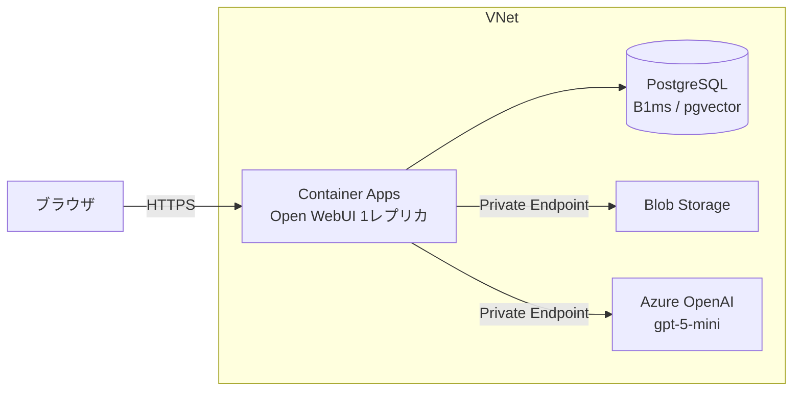

# openwebui-on-azure-paas

> Container Apps + PostgreSQL + Blob + Azure OpenAI（Private Link）のフル PaaS 構成で Open WebUI をデプロイする Bicep サンプル（AVM 使用）

**[English README is here](README.md)**

[Open WebUI](https://openwebui.com) を、Azure の PaaS だけで動かす Bicep サンプルです。**[Azure Verified Modules（AVM）](https://azure.github.io/Azure-Verified-Modules/)のモジュールだけ**で構成しています。
低コストで立ち上げられる最小構成で、データの経路（Azure OpenAI、Blob、PostgreSQL）を Private Link で閉じています。割り切った点は、[割り切ったところ](#割り切ったところ)を参照してください。

Open WebUI の公式にも、Azure Container Apps 向けのガイドがあります: <https://docs.openwebui.com/deployment/azure-container-apps>
このリポジトリは、AVM と Bicep で、同じ趣旨の構成を組んでみた、個人の検証記録です。

## 構成




| 役割 | サービス | AVM モジュール |
|---|---|---|
| アプリ（Open WebUI） | Container Apps（Consumption、1 レプリカ） | `app/container-app`、`app/managed-environment` |
| DB とベクトル検索 | Azure Database for PostgreSQL フレキシブルサーバー（B1ms、VNet 統合、`pgvector`） | `db-for-postgre-sql/flexible-server` |
| アップロードファイル | Blob Storage（Private Endpoint のみ） | `storage/storage-account` |
| LLM | Azure OpenAI（`gpt-5-mini`、Private Endpoint のみ） | `cognitive-services/account` |
| ネットワーク | VNet（3 サブネット）、Private DNS ゾーン 3 つ | `network/virtual-network`、`network/private-dns-zone` |
| ログ | Log Analytics | `operational-insights/workspace` |

- Open WebUI の DB を SQLite のままネットワーク共有（Azure Files）に置くと、ロックの問題が出るため、PostgreSQL に切り出しています。
- 検証は 1 レプリカ（最小 1、最大 1）です。複数にするなら、Redis（WebSocket）と DB 接続数の見直しが要ります。
- Blob は、Managed Identity での認証が公式に記載されていないため、ストレージキーを使っています。
- Azure OpenAI は、API キーで接続します（`disableLocalAuth: false`）。
- Azure OpenAI の接続は、`OPENAI_API_BASE_URLS` / `OPENAI_API_KEYS` / `OPENAI_API_CONFIGS` で渡します。`OPENAI_API_CONFIGS` の `model_ids` で、デプロイ済みのモデルだけに絞ります（絞らないと、Azure OpenAI が返すモデルの一覧が、全部並びます）。

## 割り切ったところ

データの経路は、Private Link で閉じています。Azure OpenAI、Blob Storage、PostgreSQL は、公開アクセスを無効にして、VNet の中（Private Endpoint と VNet 統合）からだけ繋がります。インターネットに公開されるのは、Container Apps の Open WebUI の入り口だけです。

このサンプルが、やっていないことです。

- 認証情報（PostgreSQL のパスワード、ストレージキー、Azure OpenAI の API キー）は、Container App のシークレットに入れています。Key Vault は使っていません。
- 最初に Open WebUI に登録した人が、管理者になります。URL が公開されるので、デプロイしたら、すぐに管理者アカウントを作ってください。
- PostgreSQL のパスワードの既定値は、`uniqueString` から作ります。推測できる値なので（[デプロイ](#デプロイ)を参照）、本番に近い使い方では、`-p` で自分のパスワードを指定してください。
- 冗長性はありません。レプリカは 1 つで、PostgreSQL の HA とジオ冗長バックアップは無効、ストレージは LRS です。落ちたら止まります。

## リポジトリの構成

```
openwebui-on-azure-paas/
├── main.bicep        # Bicep テンプレート（AVM のモジュールのみ）
├── main.bicepparam   # パラメータファイル（デプロイ前に編集）
└── deploy.sh         # デプロイ補助スクリプト（既定は what-if のみ）
```

## 前提条件

- Azure CLI（`az`）がインストール済みで、ログイン済みであること
- `jq` と `openssl`（`deploy.sh` が使います）
- サブスクリプションに、次のリソースプロバイダーが登録されていること: `Microsoft.App`、`Microsoft.DBforPostgreSQL`、`Microsoft.OperationalInsights`、`Microsoft.Storage`、`Microsoft.Network`、`Microsoft.CognitiveServices`
- 使うリージョンで、モデルのクォータがあること（このサンプルは、`GlobalStandard` の `gpt-5-mini` を使います）

## デプロイ

Open WebUI の秘密鍵は、実行のたびに `deploy.sh` が生成します（保存しません）。
PostgreSQL の管理者名とパスワードは、引数で渡せます。

```bash
./deploy.sh -s "<subscription>"                                  # what-if のみ。管理者名は owuiadmin、パスワードは uniqueString から生成
./deploy.sh -s "<subscription>" -u <管理者名> -p <パスワード>       # 管理者名とパスワードを指定
./deploy.sh -s "<subscription>" --apply                          # デプロイ
```

- パスワードを省略すると、`main.bicep` が `uniqueString` から作ります（`Pg1` + 英数字 26 文字）。**`uniqueString` は、サブスクリプションと RG の ID から決まる値で、ランダムではありません**（同じ入力なら、同じ値になります）。PostgreSQL は、公開アクセスを無効にして、VNet の中からしか繋がらないので、許容しています。本番に近い使い方では、`-p` で指定してください。
- パスワードは、URL に埋め込むので、英数字だけにします（大文字、小文字、数字を含めてください）。
- 環境変数（`PG_ADMIN_LOGIN`、`PG_ADMIN_PASSWORD`）でも渡せます。
- デプロイ後の接続情報は、Container App のシークレットから取得できます。

```bash
az containerapp secret show -g rg-owui-paas -n ca-owui --secret-name database-url --subscription "<subscription>" --query value -o tsv
```

検証が終わったら、リソースグループごと削除します。

```bash
az group delete -n rg-owui-paas --subscription "<subscription>" --yes
```

### 再デプロイするとき

`deploy.sh` は、`WEBUI_SECRET_KEY` を指定しないと、実行のたびに新しい鍵を生成します。鍵が変わると、ログイン済みのセッションが無効になります。
鍵を変えたくないときは、いまのシークレットを取得して、環境変数に入れてから、再デプロイします。

```bash
export WEBUI_SECRET_KEY="$(az containerapp secret show -g rg-owui-paas -n ca-owui --secret-name webui-secret-key --subscription "<subscription>" --query value -o tsv)"
```

## 費用の見積もり

東日本、730 時間/月、Retail Prices API の円換算です（2026-10-11 に取得）。実請求（2026-10-11〜15 の 5 日間）との比較は、表のあとに書いています。

| 項目 | 単価 | 月額（概算） |
|---|---|---|
| Container Apps（1 vCPU / 2GiB、常時 1 レプリカ） | 下の表を参照 | アイドル時 約 3,700 円〜アクティブ時 約 11,800 円 |
| PostgreSQL B1ms（コンピュート） | 約 4.1 円/時 | 約 3,000 円 |
| PostgreSQL ストレージ 32GB | 約 21.7 円/GB | 約 700 円 |
| Private Endpoint 2 つ（Azure OpenAI、Blob） | 約 1.58 円/時（1 つあたり） | 約 2,300 円 |
| Private DNS ゾーン 3 つ | 約 79 円/月（1 つあたり） | 約 240 円 |
| Container Apps の環境の基盤（Standard Load Balancer と、Standard の静的パブリック IP） | LB 約 3.94 円/時、IP 約 0.79 円/時（実請求から逆算） | 約 3,450 円 |
| **合計** | | **約 13,400 円〜約 21,500 円（1 日あたり約 440〜710 円）** |

Container Apps の単価（Consumption）です。

| メーター | 単価 |
|---|---|
| vCPU（アクティブ） | 約 0.0038 円/秒 |
| vCPU（アイドル） | 約 0.0005 円/秒 |
| メモリ | 約 0.0005 円/GiB 秒 |
| 無料枠（サブスクリプションごと、月ごと） | 180,000 vCPU 秒、360,000 GiB 秒 |

- アイドル料金が適用されるのは、リクエスト処理中でなく、CPU 使用率が 0.01 コア未満、ネットワークが毎秒 1,000 バイト未満のときです。この構成では、実請求でもアイドル料金になっていました（後述）。
- 含めていないもの: Azure OpenAI のトークン課金、Log Analytics（月 5GB まで無料、日次上限 1GB に設定）、通信量、Blob の容量。
- 環境の管理料金（`Environment Management`）は、Dedicated プロファイルや、環境そのものへの Private Endpoint、計画メンテナンスを使うときにかかります。この構成では使わず、請求にも出ていません。
- Container Apps の環境を作ると、`ME_` で始まる別のリソースグループに、Standard Load Balancer（`capp-svc-lb`）と Standard のパブリック IP（`capp-svc-lb-ip`）が自動で作られます。最初の見積もりには入れておらず、実請求を見て追加しました。

実請求（Cost Management、2026-10-11〜15 の 5 日間）です。

- `rg-owui-paas` が 982 円、`ME_` のリソースグループが 431 円でした。
- 丸 1 日（10/14）は、約 439 円です。月に直すと約 13,400 円で、見積もりの下限と、ほぼ同じです。
- Container Apps は、`Standard vCPU Idle Usage` と `Standard Memory Idle Usage` だけが課金されています。`Active Usage` は、1 行も出ていません。
- 無料枠は、10/13 に使い切りました。10/14 の丸 1 日は、vCPU が 86,400 秒、メモリが 172,800 GiB 秒で、全部アイドルでした。
- 検証は 1 人が触った程度なので、使い込んだときのアクティブ分は、この数字に入っていません。

## アイドル料金に入れるための調整

最小レプリカを 1 にしても、アイドル料金（アクティブの約 1/7）が適用されるのは、レプリカが次の条件をすべて満たすときです。

- リクエストを処理していない
- CPU 使用率が 0.01 コア未満
- ネットワークの受信が 1 秒あたり 1,000 バイト未満

Open WebUI をそのまま動かすと、誰も使っていなくても、受信が約 1,320 バイト/秒あり、条件を満たしませんでした（Azure Monitor の `RxBytes` で測定）。
起動ログの `Scheduler worker started (timer poll interval: 1s, ...)` から、スケジューラーのバックグラウンドの処理が原因だと推測し、次の環境変数を設定しました。

| 環境変数 | 値 | 意味 |
|---|---|---|
| `ENABLE_AUTOMATIONS` | `false` | 自動化（Automations）の処理を止める |
| `TIMER_POLL_INTERVAL` | `60` | タイマーの確認間隔を 1 秒から 60 秒にする |

アクセスなしの 10 分間の平均です（レプリカ 1、1 vCPU / 2GiB）。

| メトリクス | 変更前 | 変更後 |
|---|---|---|
| CPU | 約 0.0057 コア | 約 0.0017 コア |
| 受信 | 約 1,320 バイト/秒 | 約 307 バイト/秒 |

- メトリクスの上では、3 つの条件をすべて満たしました。実請求でも、アイドル料金で課金されていました（上の「費用の見積もり」を参照）。Container Apps には、毎月の無料枠（サブスクリプションごとに、180,000 vCPU 秒と 360,000 GiB 秒）があり、無料枠の範囲内の利用は、請求に表示されません。
- 2 つの環境変数のどちらが、どれだけ効いたかは、切り分けていません。
- これらは `ConfigVar` なので、初回起動のあとに反映するには、`--reset-config` で一度デプロイします。

## 環境変数は、初回起動のあとは効かない

Open WebUI の設定の多くは、`ConfigVar` という扱いで、**初回起動のときだけ環境変数から読まれ、以降はデータベースに保存された値が優先**されます（管理者画面での変更も、データベースに保存されます）。
そのため、Bicep の環境変数を書き換えて再デプロイしても、すでに起動したことのある環境には反映されません。反映したいときは、管理者画面で変更するか、`RESET_CONFIG_ON_START=true` を一度だけ付けて起動し直します（データベースの設定が、環境変数の値に戻ります）。付けたままだと、起動のたびにリセットされるので、反映できたら外してください。

```bash
./deploy.sh -s "<subscription>" --reset-config --apply   # 環境変数を一度だけ反映する
./deploy.sh -s "<subscription>" --apply                  # フラグを外して、もう一度デプロイする
```

## 検証結果（2026-10-11）

動作を確認できたものです（アプリのログと、チャットの動作で確認）。

- Open WebUI から、Azure OpenAI の OpenAI 互換エンドポイント（`/openai/v1`）に、API キーで繋がり、チャットできる（Azure OpenAI は、公開アクセス無効で Private Endpoint のみ）。
- Container Apps から、Private Endpoint 経由で、Blob と Azure OpenAI の名前が解決できる（Blob の公開アクセスを無効にしても、アップロードが成功する）。
- Blob への保存と読み出しが動く（アップロード 3 回で、`PUT` が 201、`GET` が 206）。
- PDF のテキスト抽出が動く（239KB の PDF をナレッジに追加して、ソース付きで回答できた）。
- `pgvector` が動く（ログに `Inserted 7 items into collection ...` と、検索結果 `query_doc:result`。`azure.extensions` の許可リストだけで、拡張を作成できた）。
- 初回起動のマイグレーションが、1 レプリカで問題なく終わり、`/health/db` が 200 を返す。
- `OPENAI_API_CONFIGS` の `model_ids` で、一覧を `gpt-5-mini` だけに絞れる（`--reset-config` を一度使った場合）。

気づいた点です。

- 画像（PNG のスクリーンショット）をナレッジに追加すると、`Error processing file` になります（テキストを取り出せないため）。Blob への保存自体は成功します。
- 埋め込みは、コンテナ内蔵のモデル（`all-MiniLM-L6-v2`）です。モデルのファイルは、コンテナ内のローカル領域にあるので、再起動のたびに取得し直されます。埋め込みの設定は `ConfigVar` で、管理者画面から変えられるので、Azure OpenAI の埋め込みモデルは、あとから試せるはずです（未確認）。
- Azure Monitor の `Transactions`（`PutBlob`）は、ログの回数より少なく表示され、`BlobCount` は 1 時間単位で遅れます。確認には、アプリのログのほうが正確でした。

## 未確認

- 使い込んだときの、アクティブ料金を含む実請求（今回は 1 人が触った程度）。
- `Standard_B1ms` の接続数の上限（ユーザー用 35）で、複数ユーザーでも足りるか（今回は 1 ユーザーのみ）。
- OCR（画像だけの PDF など）、大きなファイル、Azure OpenAI の埋め込みモデルを使う構成。

## 検証の対象外

- 複数レプリカ（Redis と DB 接続数の見直しが要る。ハードルが高いため、今回は 1 レプリカのみ）。
- PostgreSQL のテーブルの中身の直接確認（`pgvector` の挿入と検索のログで、動作を確認できているため）。
- Container Apps のカスタムドメインと無料のマネージド証明書（既定の `*.azurecontainerapps.io` のドメインのまま確認しました）。公式のドキュメント: <https://learn.microsoft.com/azure/container-apps/custom-domains-managed-certificates>

## ライセンス

[MIT](LICENSE)
