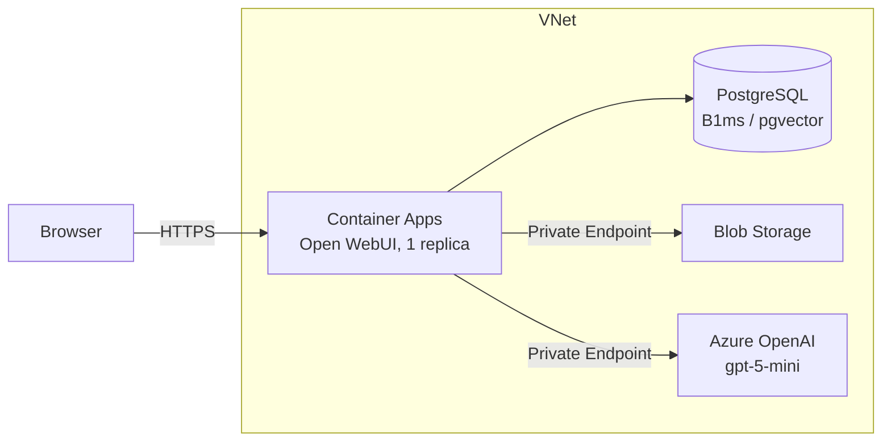

# openwebui-on-azure-paas

> Open WebUI on a fully PaaS Azure stack (Container Apps + PostgreSQL + Blob + Azure OpenAI over Private Link) with Bicep and Azure Verified Modules

**[日本語版はこちら / Japanese](README-ja.md)**

A Bicep sample that runs [Open WebUI](https://openwebui.com) on Azure PaaS services only, built **entirely from [Azure Verified Modules (AVM)](https://azure.github.io/Azure-Verified-Modules/)**.
It aims to be a minimal, relatively low-cost setup in which the data paths (Azure OpenAI, Blob, PostgreSQL) are closed with Private Link. See [Trade-offs](#trade-offs) for what it does not cover.

Open WebUI also has an official guide for Azure Container Apps: <https://docs.openwebui.com/deployment/azure-container-apps>.
This repository is a personal write-up of building that kind of stack with AVM and Bicep.

## Architecture



| Role | Service | AVM module |
|---|---|---|
| App (Open WebUI) | Container Apps (Consumption, 1 replica) | `app/container-app`, `app/managed-environment` |
| Database and vector search | Azure Database for PostgreSQL flexible server (B1ms, VNet integration, `pgvector`) | `db-for-postgre-sql/flexible-server` |
| Uploaded files | Blob Storage (private endpoint only) | `storage/storage-account` |
| LLM | Azure OpenAI (`gpt-5-mini`, private endpoint only) | `cognitive-services/account` |
| Network | VNet (3 subnets), 3 private DNS zones | `network/virtual-network`, `network/private-dns-zone` |
| Logs | Log Analytics | `operational-insights/workspace` |

- Open WebUI uses SQLite by default. Putting SQLite on a network share such as Azure Files causes locking problems, so the database is moved to PostgreSQL. See the [official troubleshooting page](https://docs.openwebui.com/troubleshooting/multi-replica).
- The sample runs a single replica (min 1, max 1). For more replicas you need Redis (WebSocket) and a review of the number of DB connections.
- Blob Storage uses the storage account key, because Open WebUI does not document managed identity support for Blob Storage.
- Azure OpenAI is accessed with an API key (`disableLocalAuth: false`).
- The Azure OpenAI connection is passed with `OPENAI_API_BASE_URLS`, `OPENAI_API_KEYS`, and `OPENAI_API_CONFIGS`. `model_ids` in `OPENAI_API_CONFIGS` restricts the model list to the deployed model (otherwise every model that Azure OpenAI returns is listed, 223 in my case).

## Trade-offs

The data paths are closed with Private Link: Azure OpenAI, Blob Storage, and PostgreSQL have public access disabled and are reachable only from inside the VNet (private endpoints and VNet integration). The only thing exposed to the internet is the Open WebUI ingress of Container Apps.

What the sample does not do:

- Secrets (the PostgreSQL password, the storage account key, and the Azure OpenAI API key) are stored as Container App secrets. Key Vault is not used.
- The first user who registers in Open WebUI becomes the administrator. The URL is public, so create the administrator account right after the deployment.
- The default PostgreSQL password is derived from `uniqueString`, which is guessable (see [Deploy](#deploy)). Pass your own with `-p` for anything closer to production.
- There is no redundancy: one replica, PostgreSQL HA and geo-redundant backup disabled, and LRS storage. If it goes down, it stays down.

## Repository structure

```
openwebui-on-azure-paas/
├── main.bicep        # Bicep template (AVM modules only)
├── main.bicepparam   # Parameter file (edit before deploying)
└── deploy.sh         # Helper script (what-if by default)
```

## Prerequisites

- Azure CLI (`az`) installed and logged in
- `jq` and `openssl` (used by `deploy.sh`)
- Resource providers registered in the subscription: `Microsoft.App`, `Microsoft.DBforPostgreSQL`, `Microsoft.OperationalInsights`, `Microsoft.Storage`, `Microsoft.Network`, `Microsoft.CognitiveServices`
- Quota for the model in your region (this sample uses `gpt-5-mini` with the `GlobalStandard` SKU)

## Deploy

`deploy.sh` generates the Open WebUI secret key on every run (it is not stored anywhere).
The PostgreSQL administrator name and password can be passed as arguments.

```bash
./deploy.sh -s "<subscription>"                                    # what-if only; admin is owuiadmin, password derived from uniqueString
./deploy.sh -s "<subscription>" -u <admin-name> -p <password>      # specify the administrator
./deploy.sh -s "<subscription>" --apply                            # deploy
```

- If you omit the password, `main.bicep` derives it from `uniqueString` (`Pg1` plus 26 alphanumeric characters). **`uniqueString` is deterministic (it depends on the subscription and resource group IDs) and is not random.** This is acceptable here because PostgreSQL has public access disabled and is reachable only from inside the VNet. For anything closer to production, pass `-p`.
- The password is embedded in a URL, so use alphanumeric characters only (include upper case, lower case, and digits).
- You can also pass `PG_ADMIN_LOGIN` and `PG_ADMIN_PASSWORD` as environment variables.
- After deployment, read the connection string from the Container App secret:

```bash
az containerapp secret show -g rg-owui-paas -n ca-owui --secret-name database-url --subscription "<subscription>" --query value -o tsv
```

When you are done, delete the resource group:

```bash
az group delete -n rg-owui-paas --subscription "<subscription>" --yes
```

### Redeploying

`deploy.sh` generates a new `WEBUI_SECRET_KEY` unless the variable is set. A new key invalidates existing logins.
To keep the key, read the current secret and export it before redeploying:

```bash
export WEBUI_SECRET_KEY="$(az containerapp secret show -g rg-owui-paas -n ca-owui --secret-name webui-secret-key --subscription "<subscription>" --query value -o tsv)"
```

## Cost estimate

Japan East, 730 hours per month, converted to JPY from the Azure Retail Prices API (retrieved on 2026-10-11). The actual bill (2026-10-11 to 15, five days) is compared after the table.

| Item | Unit price | Monthly (approx.) |
|---|---|---|
| Container Apps (1 vCPU / 2 GiB, always 1 replica) | see below | about 3,700 JPY when idle, about 11,800 JPY when active |
| PostgreSQL B1ms (compute) | about 4.1 JPY/hour | about 3,000 JPY |
| PostgreSQL storage, 32 GB | about 21.7 JPY/GB | about 700 JPY |
| Private endpoints x 2 (Azure OpenAI, Blob) | about 1.58 JPY/hour each | about 2,300 JPY |
| Private DNS zones x 3 | about 79 JPY/month each | about 240 JPY |
| Container Apps environment infrastructure (Standard Load Balancer and a Standard static public IP) | LB about 3.94 JPY/hour, IP about 0.79 JPY/hour (derived from the actual bill) | about 3,450 JPY |
| **Total** | | **about 13,400 to 21,500 JPY (about 440 to 710 JPY per day)** |

Container Apps (Consumption) unit prices:

| Meter | Unit price |
|---|---|
| vCPU (active) | about 0.0038 JPY/second |
| vCPU (idle) | about 0.0005 JPY/second |
| Memory | about 0.0005 JPY/GiB-second |
| Free grant (per subscription, per month) | 180,000 vCPU-seconds, 360,000 GiB-seconds |

- The idle rate applies only when the replica is not processing requests, uses less than 0.01 vCPU, and receives less than 1,000 bytes per second. In this setup, the actual bill also showed the idle rate (see below).
- Not included: Azure OpenAI token charges, Log Analytics (5 GB per month free; the daily cap is set to 1 GB), data transfer, and Blob capacity.
- The environment management meter (`Environment Management`) applies when you use a Dedicated profile, a private endpoint on the environment itself, or planned maintenance. This sample uses none of them, and it does not appear on the bill.
- Creating a Container Apps environment also creates a separate resource group that starts with `ME_`, containing a Standard Load Balancer (`capp-svc-lb`) and a Standard public IP (`capp-svc-lb-ip`). The first estimate did not include them; they were added after checking the actual bill.

Actual bill (Cost Management, 2026-10-11 to 15, five days):

- `rg-owui-paas` was 982 JPY and the `ME_` resource group was 431 JPY.
- A full day (10/14) was about 439 JPY. That is about 13,400 JPY per month, almost the same as the low end of the estimate.
- For Container Apps, only `Standard vCPU Idle Usage` and `Standard Memory Idle Usage` were billed. There was no `Active Usage` row.
- The free grant ran out on 10/13. The whole of 10/14 was 86,400 vCPU-seconds and 172,800 GiB-seconds, all at the idle rate.
- Only one person used it, lightly, so the active charge of heavier use is not in these numbers.

## Tuning for the idle rate

Even with a minimum of one replica, the idle rate (about 1/7 of the active rate) applies only when the replica meets all of these conditions:

- It is not processing requests
- CPU usage is below 0.01 vCPU
- Network receive is below 1,000 bytes per second

Out of the box, Open WebUI received about 1,320 bytes per second even when nobody used it, so it did not qualify (measured with `RxBytes` in Azure Monitor).
The startup log shows `Scheduler worker started (timer poll interval: 1s, ...)`, so I suspected the scheduler's background work and set these environment variables:

| Environment variable | Value | Meaning |
|---|---|---|
| `ENABLE_AUTOMATIONS` | `false` | Stop automation processing |
| `TIMER_POLL_INTERVAL` | `60` | Check timers every 60 seconds instead of every second |

Average over 10 minutes with no access (1 replica, 1 vCPU / 2 GiB):

| Metric | Before | After |
|---|---|---|
| CPU | about 0.0057 vCPU | about 0.0017 vCPU |
| Network receive | about 1,320 bytes/s | about 307 bytes/s |

- On the metrics, all three conditions are met. The actual bill also showed the idle rate (see the cost estimate above).
- Container Apps has a monthly free grant (180,000 vCPU-seconds and 360,000 GiB-seconds per subscription), and usage within the grant does not appear on the bill.
- I did not separate which of the two variables made the difference.
- These are `ConfigVar` settings, so to apply them after the first start, deploy once with `--reset-config`.

## Environment variables only apply on the first start

Most Open WebUI settings are `ConfigVar`s: **they are read from environment variables only on the first start, and the values stored in the database take precedence afterwards** (changes made in the admin UI are stored in the database as well).
Changing the environment variables in Bicep and redeploying therefore has no effect on an environment that has already started.
To apply the change, either edit the setting in the admin UI, or start once with `RESET_CONFIG_ON_START=true` (this resets the database settings to the environment variable values). Remove it afterwards, because it resets the settings on every start.

```bash
./deploy.sh -s "<subscription>" --reset-config --apply   # apply the environment variables once
./deploy.sh -s "<subscription>" --apply                  # then redeploy without the flag
```

## Verified (2026-10-11)

Confirmed with the application logs and by using the app:

- Chat works from Open WebUI to Azure OpenAI through the OpenAI-compatible endpoint (`/openai/v1`) with an API key (Azure OpenAI has public access disabled, private endpoint only).
- Names resolve through the private endpoints from Container Apps (uploads to Blob succeed with public access disabled).
- Blob upload and download work (3 uploads: `PUT` returned 201, `GET` returned 206).
- PDF text extraction works (a 239 KB PDF was added to a knowledge base and the chat answered with the source).
- `pgvector` works (the log shows `Inserted 7 items into collection ...` and the search result `query_doc:result`; the extension could be created with only the `azure.extensions` allow list).
- The migration on the first start finished without problems with one replica, and `/health/db` returns 200.
- `model_ids` in `OPENAI_API_CONFIGS` restricts the list to `gpt-5-mini` (after using `--reset-config` once).

Things I noticed:

- Adding an image (a PNG screenshot) to a knowledge base fails with `Error processing file`, because no text can be extracted. Saving the file to Blob still succeeds.
- Embeddings use the model bundled in the container (`all-MiniLM-L6-v2`). The model files are on the container's local storage, so they are downloaded again on every restart. The embedding settings are `ConfigVar`s that can be changed in the admin UI, so an Azure OpenAI embedding model should be possible later (not tested).
- In Azure Monitor, `Transactions` (`PutBlob`) showed fewer calls than the log, and `BlobCount` lags by an hour. The application log was more reliable for verification.

## Not verified

- The actual bill including active charges under heavier use (only one person used it, lightly).
- Whether the `Standard_B1ms` connection limit (35 for users) is enough for several users (only one user was tested).
- OCR (for example, PDFs that contain only images), large files, and using an Azure OpenAI embedding model.

## Out of scope

- Multiple replicas (needs Redis and a review of DB connections; the sample runs one replica).
- Inspecting the PostgreSQL tables directly (the `pgvector` insert and search logs were enough).
- Custom domains and free managed certificates for Container Apps (the default `*.azurecontainerapps.io` domain was used). See the official documentation: <https://learn.microsoft.com/azure/container-apps/custom-domains-managed-certificates>

## License

[MIT](LICENSE)
